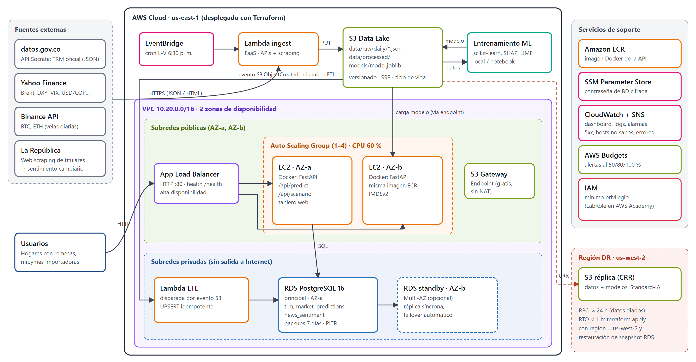

# TRM Predict: analítica predictiva en la nube para el riesgo cambiario en Colombia

Proyecto integrador de V semestre (Minería de Datos, Machine Learning y Cloud Computing).
**ODS 8** (trabajo decente y crecimiento económico, meta 8.10) y **ODS 10** (reducción de desigualdades, meta 10.c, remesas).

El sistema pronostica, para el siguiente día hábil, la **dirección** de la TRM (COP/USD), su **valor esperado**
y la **probabilidad de un movimiento fuerte**. Así, hogares que reciben remesas y mipymes importadoras pueden
decidir cuándo monetizar o comprar dólares, o cuándo cubrirse.



## Estructura

```
src/ingest/        Adquisición: APIs (TRM datos.gov.co, Yahoo Finance, Binance) y web scraping (La República)
src/pipeline/      KDD/CRISP-DM: prepare (limpieza + features), eda, unsupervised (PCA, clustering, reglas), train (ML)
api/               API REST FastAPI + tablero web (Docker)
lambdas/           Lambda de ingesta diaria y Lambda de ETL hacia RDS
infra/terraform/   Infraestructura como código (VPC, S3+CRR, RDS, ALB+ASG, Lambda, CloudWatch, Budgets)
scripts/           build_lambdas.sh, deploy_api.sh
docs/              Propuesta IEEE (EN/ES), diagrama de arquitectura, análisis de costos
reports/           Métricas y figuras generadas por el pipeline
```

## Ejecutar el pipeline en local

```bash
python -m venv .venv && .venv/Scripts/activate      # Linux/Mac: source .venv/bin/activate
pip install -r requirements.txt

python -m src.ingest.run              # 1. Adquisición (JSON/CSV en data/raw, titulares en data/raw/news)
python -m src.pipeline.prepare        # 2. Limpieza, integración y variables -> data/processed/dataset.csv
python -m src.pipeline.eda            # 3. EDA -> reports/eda_*.json, reports/figures/eda_*.png
python -m src.pipeline.unsupervised   # 4. PCA, K-Means, jerárquico, DBSCAN, Apriori y FP-Growth
python -m src.pipeline.train          # 5. Modelos, Grid/Random Search, SHAP, LIME -> models/model.joblib

uvicorn api.app:app --port 8000       # API + tablero en http://localhost:8000
```

## Desplegar en AWS

Requisitos: Terraform ≥ 1.6, AWS CLI configurado y Docker.

```bash
bash scripts/build_lambdas.sh
cd infra/terraform
cp terraform.tfvars.example terraform.tfvars   # en AWS Academy: lab_role_name = "LabRole", etc.
terraform init && terraform apply

# Primera carga histórica en RDS (luego corre sola cada día hábil)
aws lambda invoke --function-name $(terraform output -raw ingest_lambda) \
  --payload '{"backfill": true}' --cli-binary-format raw-in-base64-out out.json

cd ../.. && bash scripts/deploy_api.sh        # imagen a ECR + modelo a S3 + instance refresh
```

Al terminar cada sesión: `terraform destroy` (ver `docs/costos.md`).

### Pruebas para la sustentación

- **Alta disponibilidad**: terminar una instancia del ASG desde la consola. El ALB sigue respondiendo y el
  ASG lanza un reemplazo. El tablero muestra qué instancia atendió cada petición.
- **Auto-scaling**: `hey -z 5m -c 50 http://<alb>/api/predict` (o `ab`) y observar en el tablero de CloudWatch
  cómo sube la CPU y aumenta el número de instancias.
- **Failover de BD** (con `db_multi_az = true`): `aws rds reboot-db-instance --force-failover`.
- **DR**: verificar que los objetos aparecen en el bucket réplica de us-west-2.

## Endpoints

| Método | Ruta | Descripción |
|---|---|---|
| GET | `/health` | Health check del ALB |
| GET | `/api/predict` | Probabilidad de alza, TRM esperada y riesgo de movimiento fuerte |
| POST | `/api/scenario` | Qué pasaría si: `{"shocks": {"brent_ret_1": -0.03}}` |
| GET | `/api/history?days=180` | Serie de la TRM |
| GET | `/api/model` | Modelos elegidos, métricas de prueba y top SHAP |
| GET | `/` | Tablero web |

## Fuentes de datos

| Fuente | Tipo | Uso |
|---|---|---|
| datos.gov.co `32sa-8pi3` (Superfinanciera) | API JSON | TRM oficial diaria desde 1991 |
| Yahoo Finance chart API | API JSON → CSV | Brent, DXY, US10Y, VIX, S&P 500, USD/MXN, USD/BRL, USD/COP |
| Binance `/api/v3/klines` | API JSON → CSV | BTC y ETH diarios |
| larepublica.co (Finanzas, Economía, Globoeconomía) | Web scraping HTML | Titulares e índice de sentimiento cambiario diario |

Aviso: es un proyecto académico, no una recomendación de inversión.
