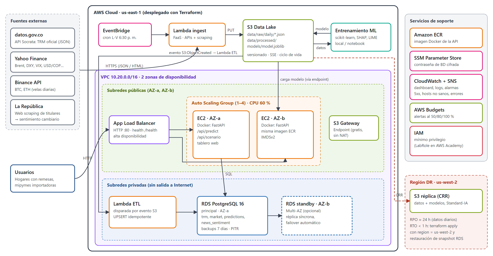

# TRM Predict: sistema en la nube para anticipar el riesgo cambiario en compras de iPhone en Colombia

Proyecto integrador de V semestre (Minería de Datos, Machine Learning y Cloud Computing).
**ODS 8** (trabajo decente y crecimiento económico, pymes) y **ODS 9** (industria, innovación e infraestructura en la nube).

El sistema pronostica, para el siguiente día hábil, la **dirección** de la TRM (COP/USD), su **valor esperado**
y la **probabilidad de un movimiento fuerte**. El usuario principal es el **importador de iPhone**: compra el
equipo en dólares en EE. UU., lo trae con casillero y lo vende en pesos. La página le muestra, para el modelo de
iPhone que elija, el precio en USD, el costo en COP con la TRM de hoy frente a la esperada para mañana y la
recomendación de **comprar hoy o esperar**. El modelo predice la TRM, no el precio del iPhone.



## Estructura

```
src/ingest/        Adquisición: APIs (TRM datos.gov.co, Yahoo Finance, Binance) y web scraping (La República)
src/pipeline/      KDD/CRISP-DM: prepare (limpieza + features), eda, unsupervised (PCA, clustering, reglas), train (ML)
api/               API REST FastAPI + tablero web (Docker)
lambdas/           Lambda de ingesta diaria y Lambda de ETL hacia RDS
infra/terraform/   Infraestructura como código (VPC, S3+CRR, RDS, ALB+ASG, Lambda, CloudWatch, Budgets)
scripts/           build_lambdas.sh, deploy_api.sh
docs/              Propuesta IEEE (EN/ES), diagrama de arquitectura, análisis de costos
reports/           Métricas y figuras generadas por el pipeline
```

## Ejecutar el pipeline en local

```bash
python -m venv .venv && .venv/Scripts/activate      # Linux/Mac: source .venv/bin/activate
pip install -r requirements.txt

python -m src.ingest.run              # 1. Adquisición (JSON/CSV en data/raw, titulares en data/raw/news)
python -m src.pipeline.prepare        # 2. Limpieza, integración y variables -> data/processed/dataset.csv
python -m src.pipeline.eda            # 3. EDA -> reports/eda_*.json, reports/figures/eda_*.png
python -m src.pipeline.unsupervised   # 4. PCA, K-Means, jerárquico, DBSCAN, Apriori y FP-Growth
python -m src.pipeline.elbow          # 4b. K-Means con k elegido por el método del codo -> reports/elbow.json
python -m src.pipeline.kmeans_validation  # 4c. Validación del K-Means por fases -> reports/kmeans_validation.json, docs/kmeans/
python -m src.pipeline.train          # 5. Modelos, Grid/Random Search, SHAP, LIME -> models/model.joblib

uvicorn api.app:app --port 8000       # API + tablero en http://localhost:8000
```

## Desplegar en AWS

Requisitos: Terraform ≥ 1.6, AWS CLI configurado y Docker.

```bash
bash scripts/build_lambdas.sh
cd infra/terraform
cp terraform.tfvars.example terraform.tfvars   # en AWS Academy: lab_role_name = "LabRole", etc.
terraform init && terraform apply

# Primera carga histórica en RDS (luego corre sola cada día hábil)
aws lambda invoke --function-name $(terraform output -raw ingest_lambda) \
  --payload '{"backfill": true}' --cli-binary-format raw-in-base64-out out.json

cd ../.. && bash scripts/deploy_api.sh        # imagen a ECR + modelo a S3 + instance refresh
```

Al terminar cada sesión: `terraform destroy` (ver `docs/costos.md`).

### Pruebas para la sustentación

- **Alta disponibilidad**: terminar una instancia del ASG desde la consola. El ALB sigue respondiendo y el
  ASG lanza un reemplazo. El tablero muestra qué instancia atendió cada petición.
- **Auto-scaling**: `hey -z 5m -c 50 http://<alb>/api/predict` (o `ab`) y observar en el tablero de CloudWatch
  cómo sube la CPU y aumenta el número de instancias.
- **Failover de BD** (con `db_multi_az = true`): `aws rds reboot-db-instance --force-failover`.
- **DR**: verificar que los objetos aparecen en el bucket réplica de us-west-2.

## Endpoints

| Método | Ruta | Descripción |
|---|---|---|
| GET | `/health` | Health check del ALB |
| GET | `/api/predict` | Probabilidad de alza, TRM esperada y riesgo de movimiento fuerte |
| POST | `/api/scenario` | Qué pasaría si: `{"shocks": {"brent_ret_1": -0.03}}` |
| GET | `/api/history?days=180` | Serie de la TRM |
| GET | `/api/model` | Modelos elegidos, métricas de prueba y top SHAP |
| GET | `/api/iphone/config` | Modelos de iPhone y parámetros de costo de ejemplo (`api/iphone_config.json`) |
| POST | `/api/importador/decision` | ¿Compro el iPhone hoy, espero a mañana o no es viable? `{"modelo": "iPhone 17 256 GB", "precio_usd": 929, "peso_kg": 0.5, "venta_cop": 4250000, "impuestos_pct": 0}` |
| POST | `/api/importador/historial` | Margen real, efecto de la TRM y de la señal sobre los pedidos del importador |
| GET | `/` | Tablero web |

## Importadores de iPhone (EE. UU. → Colombia)

Para quien compra iPhone en EE. UU., los trae con casillero y los vende en pesos. Es el módulo principal de la página.

- **Parámetros** en `api/iphone_config.json`: modelos de iPhone con precio en USD, peso y precio de venta, tarifa del casillero por kg, recargo del banco, impuestos y otros cargos (%) y margen mínimo. Los precios en USD son los de apple.com (EE. UU., configuración base, sin impuesto de ventas) consultados el 2026-11-24 y deben verificarse. **El resto son valores de ejemplo, marcados "ejemplo, verificar"**: no son tarifas ni normas oficiales. El porcentaje de impuestos viene en 0 % para que cada importador ponga el que le aplique.
- **Costo puesto en Colombia** = (precio + casillero × kg redondeados hacia arriba) × TRM × (1 + recargo del banco) × (1 + impuestos y otros).
- **Regla**: esperar a mañana si P(baja) ≥ 55 % y el régimen K-Means no es Crisis. Si no, comprar hoy. Si el margen no llega al mínimo ni con la TRM optimista de mañana, el pedido no es viable.
- **Validación** (`python -m src.pipeline.evaluate_importador` → `reports/importador_eval.json`): en el periodo de prueba (2024-12 a 2026-10), cuando la regla dijo "espera" acertó el 63 % de las veces y ahorró en promedio COP 9.900 por cada USD 1.000. Esperar al azar dio COP 1.383 por día y la regla COP 2.315 por cada USD 1.000. El periodo fue de peso apreciándose, así que esperar al azar también ganaba.
- El régimen del día se calcula en la API con `api/regimes.json` (`python -m src.pipeline.regime_export`, el mismo K-Means de `elbow.py`).
- El historial de pedidos se guarda en el navegador del usuario (localStorage); la API solo lo analiza.

## Fuentes de datos

| Fuente | Tipo | Uso |
|---|---|---|
| datos.gov.co `32sa-8pi3` (Superfinanciera) | API JSON | TRM oficial diaria desde 1991 |
| Yahoo Finance chart API | API JSON → CSV | Brent, DXY, US10Y, VIX, S&P 500, USD/MXN, USD/BRL, USD/COP |
| Binance `/api/v3/klines` | API JSON → CSV | BTC y ETH diarios |
| larepublica.co (Finanzas, Economía, Globoeconomía) | Web scraping HTML | Titulares e índice de sentimiento cambiario diario |

Aviso: es un proyecto académico, no una recomendación de inversión.

## Avance del proyecto integrador (14 de noviembre de 2026)

Reporte de avance en formato IEEE: `docs/avance/avance.tex` (figuras en `docs/avance/fig/`). Se compila en Overleaf con pdfLaTeX subiendo la carpeta `docs/avance` completa.

| Módulo de los lineamientos | Evidencia en el repositorio |
|---|---|
| A. Documento técnico (introducción, problema y ODS, estructura del sistema) | `docs/avance/avance.tex`, secciones I a III |
| B. Minería de Datos: dataset limpio | `data/processed/dataset.csv`, `src/pipeline/prepare.py` |
| B. Nulos y outliers | `reports/data_quality.json` |
| B. EDA | `src/pipeline/eda.py`, `reports/eda_*.json`, `reports/figures/eda_*.png` |
| B. Web scraping y fuentes externas | `src/ingest/scraper.py`, `src/ingest/apis.py`, `data/raw/news/` |
| B. Clustering y reglas de asociación | `src/pipeline/unsupervised.py`, `src/pipeline/elbow.py`, `reports/unsupervised.json`, `reports/association_rules_top.csv` |
| C. Cloud: diagrama de arquitectura | `docs/arquitectura.png` |
| C. Infraestructura como Código | `infra/terraform/` (Terraform, AWS) |
| C. Pruebas de disponibilidad y carga | `scripts/experiments/`, `reports/experiments/` |
| C. Estimación de costos | `docs/costos.md` |
| D. Integración con Machine Learning | `src/pipeline/train.py`, `reports/model_results.json`, `models/` |
